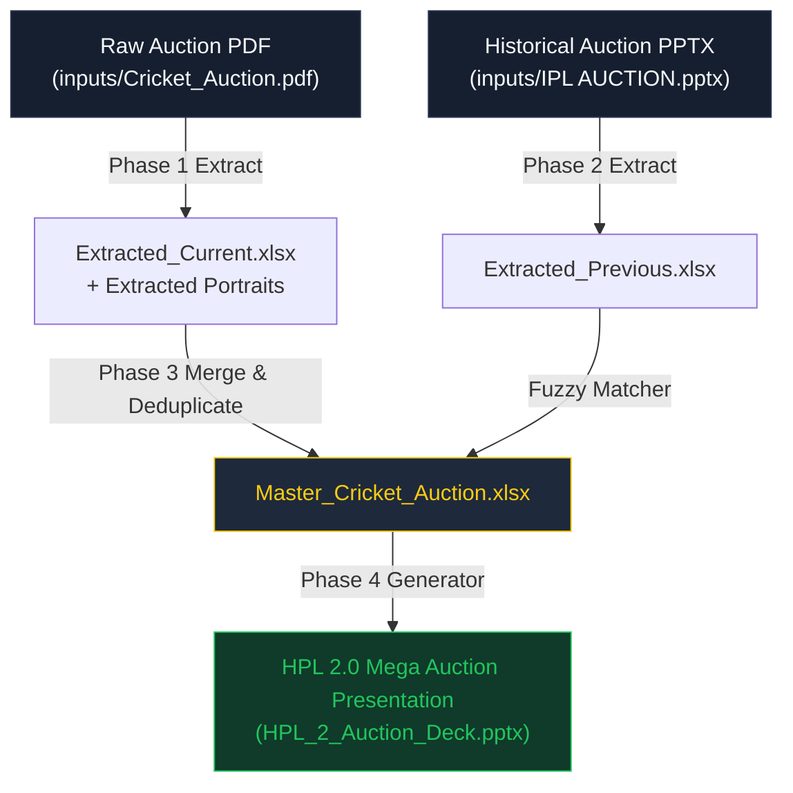

# 🏏 HPL 2.0 — Mega Player Auction Deck Generator & PDF-PPTX Modular Toolkit 🚀

[](https://www.python.org/)
[](https://python-pptx.readthedocs.io/)
[](https://pymupdf.readthedocs.io/)
[](#-visual-design-system)
[](#-visual-design-system)
[](#-privacy--data-hygiene)

A high-performance, modular Python engineering toolkit designed to automate the conversion, extraction, compression, deduplication, and presentation generation for **Cricket Player Auctions** (such as **HPL 2.0**).

Whether you need to convert multi-hundred-page auction PDF brochures into PowerPoint decks, extract player statistics and isolated portraits, or generate high-impact broadcast-style auction slides in seconds, this toolkit provides a comprehensive, production-grade pipeline.

---

## 📑 Table of Contents

- [🌟 Key Features](#-key-features)
- [🎨 Visual Design System](#-visual-design-system)
- [📁 Repository Structure](#-repository-structure)
- [⚡ Quick Start Guide](#-quick-start-guide)
- [🛠️ Standalone Auction Generator (`generate_hpl2_deck.py`)](#️-standalone-auction-generator-generate_hpl2_deckpy)
- [🔄 End-to-End Pipeline Workflow](#-end-to-end-pipeline-workflow)
- [🎛️ Interactive Menu & CLI Commands](#️-interactive-menu--cli-commands)
- [🔒 Privacy & Data Hygiene](#-privacy--data-hygiene)
- [⚙️ Configuration & Customization](#️-configuration--customization)
- [📜 License](#-license)

---

## 🌟 Key Features

* **🏏 Standalone HPL 2.0 Auction Deck Generator (`generate_hpl2_deck.py`)**:
  * Produces broadcast-ready 16:9 widescreen presentation slides (`13.333" x 7.5"`).
  * Automatically handles category set divider titles, player portraits, role badges, country tags, rating badges, and electric green base price containers.
  * Zero external template dependencies — uses native PowerPoint vector geometry for razor-sharp rendering.
* **⚡ Instant Preview Mode (`--sample`)**:
  * Build an instant demo auction deck without requiring any raw input files or pre-extracted assets.
* **🏷️ Fully Generalized & Configurable**:
  * All tournament metadata (League Title, Tagline, Subtitle, Event Badge, Organizer Footer) can be dynamically customized via command-line arguments.
* **📄 Multi-Engine PDF Converter (`src/pdf_tools/converter/`)**:
  * High-DPI rasterization preserving source aspect ratio (4:3 or 16:9 widescreen) with selective page range rendering.
* **✂️ Bounds-Checked Page Selector (`src/pdf_tools/page_selector/`)**:
  * Extract arbitrary ranges (e.g., `1-4, 85-87, 182-185`) into a compact sub-document.
* **🗜️ PDF Compressor (`src/pdf_tools/compressor/`)**:
  * Stream deflater and garbage collection optimizing large PDF auction books.
* **🔍 Multi-Phase Data Extraction & Deduplication**:
  * **Phase 1 (PDF Extractor)**: Extracts names, roles, base prices, ratings, and isolates cropped player portraits.
  * **Phase 2 (PPTX Extractor)**: Un-nests recursive GroupShapes from previous auction decks to capture historical data.
  * **Phase 3 (Merger)**: Fuzzy string matching deduplicates and consolidates current and historical player catalogs into a Master Excel database.
* **🎛️ Dual Operating Modes**:
  * Interactive terminal menu with numbered choices, or modular command-line subcommands.

---

## 🎨 Visual Design System

The auction presentation is styled using a modern **Stadium Dark & Gold** broadcast palette:

| Element | Hex Code | RGB | Purpose |
| :--- | :---: | :---: | :--- |
| **Canvas Background** | `#0B0F19` | `11, 15, 25` | Deep Navy Dark canvas |
| **Card Container** | `#161F30` | `22, 31, 48` | Rounded slate surface container |
| **Subtle Border** | `#27354F` | `39, 53, 79` | Precision shape outlines |
| **Gold Accent** | `#FACC15` | `250, 204, 21` | Category titles, League headers & Ratings |
| **Base Price Box** | `#22C55E` | `34, 197, 94` | High-visibility Electric Green base price |
| **Role Badge** | `#1E293B` | `30, 41, 59` | Slate blue pill container with electric border |
| **Country (India)** | `#103A2A` | `16, 58, 42` | Dark forest green pill with emerald border |
| **Country (Overseas)** | `#33234E` | `51, 35, 78` | Dark royal purple pill with violet border |
| **White Text** | `#F8F9FA` | `248, 249, 250` | Primary player typography |
| **Secondary Text** | `#9CA3AF` | `156, 163, 175` | Footers & secondary labels |

### 📐 Slide Blueprint:
* **Slide 1 (Cover / Header Slide)**:
  * Top Tagline Pill: `HPL PREMIER LEAGUE` (Gold border)
  * League Title: `HPL 2.0` (60pt bold Gold)
  * Subtitle: `OFFICIAL MEGA PLAYER AUCTION 2026` (28pt bold White)
  * Status Pill: `LIVE SQUAD SELECTION & BIDDING` (Emerald Green)
  * Footer: `Organized by Tournament Committee` (Light Gray, 18pt)
* **Slides 2+ (Player Auction Cards)**:
  * **Category Bar**: Top header designating the auction set (e.g., `SET 1: MARQUEE BATSMEN`).
  * **Portrait Frame (Left)**: `4.0" x 4.8"` rounded frame auto-scaling player photos, with fallback text if absent.
  * **Player Details (Right)**:
    * 40pt bold white name banner with dynamic auto-shrinking for long names.
    * Role pill badge (`BATSMAN`, `BOWLER`, `ALL-ROUNDER`, `WICKETKEEPER`).
    * Nationality pill badge (`INDIA`, `OVERSEAS`).
    * Rating container (`RATING: 9.8 / 10` in Gold).
  * **Base Price Callout (Bottom Right)**: High-contrast Electric Green border and typography (`BASE PRICE: ₹ 2.00 Cr`, 32pt bold).

---

## 📁 Repository Structure

```text
pdf-ppt-hpl-mix/
│
├── generate_hpl2_deck.py          # 🏏 Standalone HPL 2.0 Auction Presentation Generator
├── main.py                        # 🚀 Primary interactive launcher & CLI entrypoint
├── run.py                         # ⚡ Quick alias runner for main.py
├── compressor.py                  # 🗜️ Standalone PDF compression utility
├── select_pages.py                # ✂️ Standalone PDF page extraction utility
├── phase1_extract_pdf.py          # 📄 Phase 1: PDF player & portrait extractor
├── phase2_extract_pptx.py         # 📊 Phase 2: Previous PPTX shape extractor
├── phase3_merge_cli.py            # 🔄 Phase 3: Player catalog consolidation & fuzzy merge
├── phase4_generate_pptx.py        # 🎨 Phase 4: Full presentation generator entrypoint
├── requirements.txt               # 📦 Project dependencies
├── .gitignore                     # 🛡️ Privacy filter (excludes raw inputs, outputs, binary assets)
├── README.md                      # 📖 Comprehensive documentation
│
├── inputs/                        # 📥 Directory for raw input brochures & source PPTX
│   └── .gitkeep                   # (Source data files remain private & git-ignored)
│
├── outputs/                       # 📤 Directory for generated datasets, photos & presentations
│   └── .gitkeep                   # (Output artifacts remain private & git-ignored)
│
├── docs/                          # 📚 Engineering Documentation
│   ├── ARCHITECTURE.md            # Deep dive into system architecture & modular design
│   ├── USER_GUIDE.md              # Operations manual for interactive & CLI modes
│   └── MISTAKES_AND_FIXES.md      # Bug autopsy and resolutions
│
└── src/                           # 🧠 Modular Core Package
    ├── common/                    # Shared settings, constants, and path resolvers
    │   ├── config/settings.py     # Theme palettes, aspect ratios, default paths
    │   └── utils/                 # File helpers and text sanitation
    ├── pdf_tools/                 # Converter, page selector, and compressor engines
    ├── auction_pipeline/          # PDF extractors, PPTX shape walkers, and merger
    └── cli/                       # Terminal menu loop and CLI dispatcher
```

---

## ⚡ Quick Start Guide

### 1️⃣ Clone & Setup
```bash
git clone https://github.com/tninanofchirawa/pdf-ppt-hpl-mix.git
cd pdf-ppt-hpl-mix
```

### 2️⃣ Install Dependencies
```bash
pip install -r requirements.txt
```

### 3️⃣ Generate an Instant Sample Presentation
No data files required! Run the standalone generator with the `--sample` flag:
```bash
python generate_hpl2_deck.py --sample -o "HPL_2_Sample_Deck.pptx"
```
🎉 Your presentation is generated instantly at `HPL_2_Sample_Deck.pptx`.

---

## 🛠️ Standalone Auction Generator (`generate_hpl2_deck.py`)

The generator can be executed directly with custom datasets, or configured dynamically:

```bash
# Generate presentation using default Master Excel dataset
python generate_hpl2_deck.py

# Generate presentation from custom CSV or Excel dataset
python generate_hpl2_deck.py -i "my_squads.csv" -o "outputs/Auction_Deck_2026.pptx"

# Customize cover slide headers and organization on the fly
python generate_hpl2_deck.py --sample \
  --title "HPL 2.0" \
  --tagline "HINDUSTAN PREMIER LEAGUE" \
  --subtitle "OFFICIAL MEGA AUCTION" \
  --organizer "Tournament Organizing Committee"
```

### Generator Arguments:
| Argument | Flag | Default | Description |
| :--- | :---: | :--- | :--- |
| `--input` | `-i` | `outputs/Master_Cricket_Auction.xlsx` | Path to CSV/Excel player records |
| `--output` | `-o` | `HPL_2_Auction_Deck.pptx` | Output PowerPoint file destination |
| `--sample` | | `False` | Uses built-in marquee stars |
| `--title` | | `"HPL 2.0"` | Main title on Slide 1 |
| `--tagline` | | `"HPL PREMIER LEAGUE"` | Top pill badge on Slide 1 |
| `--subtitle` | | `"OFFICIAL MEGA PLAYER AUCTION 2026"` | Subtitle on Slide 1 |
| `--organizer`| | `"Organized by Tournament Committee"` | Footer text on Slide 1 |
| `--event-tag`| | `"LIVE SQUAD SELECTION & BIDDING"` | Green event badge on Slide 1 |

---

## 🔄 End-to-End Pipeline Workflow



1. **Phase 1: PDF Player & Portrait Extraction**:
   Reads the source auction PDF, extracts player records (role, points, country), and isolates portraits into `outputs/images_current/`.
   ```bash
   python main.py extract-pdf
   ```
2. **Phase 2: Historical PPTX Extraction**:
   Unpacks previous auction decks via recursive shape walking to build historical baseline metrics.
   ```bash
   python main.py extract-pptx
   ```
3. **Phase 3: Catalog Consolidation & Merge**:
   Fuzzy-matches records between seasons, resolves discrepancies, and outputs a consolidated `Master_Cricket_Auction.xlsx`.
   ```bash
   python main.py merge --auto
   ```
4. **Phase 4: Deck Generation**:
   Transforms the master catalog into the final Stadium Dark widescreen PowerPoint presentation deck.
   ```bash
   python main.py generate-pptx
   ```

---

## 🎛️ Interactive Menu & CLI Commands

### 🌟 Interactive Menu
Launch the terminal user interface:
```bash
python main.py
# or
python run.py
```
```text
================================================================
      CRICKET AUCTION & PDF-TO-PPTX CONVERTER TOOLKIT
================================================================
  [1] Convert PDF to PowerPoint (Direct Page Rasterizer)
  [2] Select / Extract Specific Pages from PDF
  [3] Compress PDF File Size
  [4] Phase 1: Extract Player Stats & Photos from PDF
  [5] Phase 2: Extract Previous PPTX Auction Data
  [6] Phase 3: Consolidate & Merge Datasets
  [7] Phase 4: Generate Branded Auction Presentation (PPTX)
  [8] Run Complete Pipeline (Phase 1 -> 3 -> 4 End-to-End)
  [9] Inspect Workspace File Status
  [0] Exit
================================================================
```

### ⚡ CLI Subcommands
Run any step non-interactively:
```bash
# Convert PDF pages directly to PowerPoint slides (preserves 4:3 or 16:9)
python main.py convert --input "my_doc.pdf" --aspect-ratio match

# Extract selected pages
python main.py select -p "1-5, 20-25" -o "outputs/selected.pdf"

# Compress PDF
python main.py compress -i "large.pdf" -o "compressed.pdf"

# Execute full pipeline end-to-end
python main.py pipeline
```

---

## 🔒 Privacy & Data Hygiene

This repository is configured to prioritize **data privacy** and clean version control:

* **🛡️ Gitignore Protection**:
  * Raw input PDF documents (`inputs/*.pdf`) and presentation decks (`inputs/*.pptx`) are strictly excluded.
  * Generated Excel master sheets (`outputs/*.xlsx`) and extracted portrait folders (`outputs/images_current/`) are strictly ignored.
  * Intermediate scratch files (`scratch/*`) and compiled Python bytecode (`__pycache__/`) are never tracked.
* **📦 Sample-Ready**:
  * The project ships with built-in marquee player fallbacks (`--sample`) so anyone can verify and run the codebase without needing proprietary datasets.
* **🏷️ Generalized Defaults**:
  * All institutional headers, club names, and tournament titles default to customizable generic placeholders that can be updated cleanly at runtime.

---

## ⚙️ Configuration & Customization

All styling variables, aspect ratios, and file paths are centralized in [`src/common/config/settings.py`](file:///src/common/config/settings.py):

* **Palette Customization**: Easily modify `THEME_COLOR_BG`, `THEME_COLOR_GOLD`, and `THEME_COLOR_PRICE_GREEN`.
* **Dimensions**: Switch between `16:9` widescreen (`13.333" x 7.5"`) or `4:3` standard (`10.0" x 7.5"`).
* **Base Price Mapping**: Adjust default pricing thresholds inside `generate_hpl2_deck.py` -> `normalize_base_price()`.

---

## 📜 License

Distributed under the **MIT License**. See `LICENSE` for details.
Built with ❤️ for sports analytics and automated auction deck generation.
